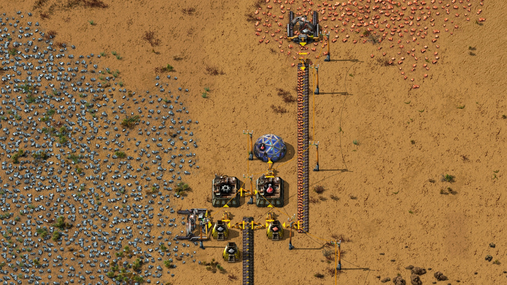

# Factorio NPC


[](LICENSE)

**SGLuna is an AI teammate that lives inside a Factorio world.** It controls a
standalone character with real inventory, crafting and mining, and can operate
on a headless server with nobody connected.

**[Install](#install-and-connect-your-ai-assistant) · [Latest proof](#latest-proof) · [Choose your harness](#choose-your-harness)**

---

## Install and connect your AI assistant

The `main` branch lets a local AI harness control your
standalone Factorio NPC through MCP. Your assistant
plans the work and directs native game actions through a local connection.

This mode is experimental and separate from the built-in autonomous planner.
**Quick setup:** paste this into an assistant with local command access
and automatic setup enabled:

```text
Set up https://github.com/TTLouis/factorio-npc/tree/main
for this harness. Follow the repository setup instructions and stop when ready
for my goal.
```

The [portable setup instructions](docs/EXTERNAL_HARNESS_SETUP.md) let the
assistant prepare a private game, connect your harness and verify it is ready.
They cover different local harnesses and explain what remote-only clients need.

> [!TIP]
> Setup prepares the connection and stops ready for your goal. Your assistant
> needs local command access, runtime permissions and authorized Factorio access.

Once setup is complete, give your connected assistant a goal in its own chat.
The assistant observes the world through MCP, plans the work, submits bounded
game actions and reads their results before deciding what to do next. You can
review its progress and redirect it through your usual harness conversation.

The game bridge validates actions and returns native observations and operation
receipts. Your assistant handles planning and responding to refusals or changed
conditions. Computer vision is not required. For manual setup and tool usage,
see the [runtime guide](docs/EXTERNAL_HARNESS.md). The assistant can consult the
[knowledge and gameplay method library](docs/EXTERNAL_HARNESS.md#read-only-method-library)
for methods, and use current game observations for recipes and other game facts.

**Status: experimental external-harness integration.** Results depend on your
assistant, model and goal. The [latest proof](#latest-proof) documents measured
automatic science production and lab delivery, with the remaining limitations.
It does not establish reliable completion of arbitrary gameplay goals.

---

## Choose your harness

All three modes use one codebase on `main`, one native mod and shared world tools.
Select a lifecycle at startup; no branch switch is needed.

| Mode | How it works |
| --- | --- |
| `external` | Your external assistant plans and operates the NPC through stdio MCP. |
| `plan` | Built-in planner and executor follow committed plans and step contracts; Jev is optional. |
| `pursuit` | One built-in operator uses tools, a notebook and native goal evaluation with bounded continuation. |

See [mode selection and setup](docs/HARNESS_MODES.md) for commands, requirements,
compatibility entrypoints and the preserved safety boundaries. All modes remain
experimental; historical evidence applies only to its recorded candidate.

---

## Latest proof

### Electrified starter base with automatic red science

**November 5, 2026 · External harness · Factorio 2.0.77**

| New science packs | Hands-off measurement | Delivery |
| :---: | :---: | :---: |
| **21** | **10 min 19 sec** | **Electric mining, automatic fuel and lab feed** |

The external operator built a starter base from an empty NPC inventory in a
fresh world, with electric coal, iron and copper mining. After construction,
the assembler produced 21 new packs during an independent hands-off window at
normal game speed, with automatic furnace and boiler fuel service and science
delivered to a researching lab.



*Inspection screenshot of the preserved post-stop world. Production counts
come from the original native measurements, not the screenshot.*

> [!NOTE]
> **Limits:** one furnace per ore, one electric coal drill and a self-fuelling
> burner inserter at the boiler. Output was modest; compatibility with later
> first-player crash-site creation remains unproven. This external-operator
> result does not validate built-in plan or pursuit mode.

**[Read the proof and screenshots](docs/proofs/2026-11-05-electrified-starter-base.md)
· [Browse all proofs](docs/proofs/README.md)**

---

## Start here

| Your goal | Next step |
| --- | --- |
| Connect an external AI harness | [Portable setup](docs/EXTERNAL_HARNESS_SETUP.md), [runtime/tool guide](docs/EXTERNAL_HARNESS.md) |
| Run SGLuna on your own server | [Docker setup](deploy/docker/README.md) or [Pterodactyl setup](deploy/pterodactyl/README.md) |
| Help with a bug, test or explanation | [Contributing](CONTRIBUTING.md) |
| Understand the design | [Project contract](SPEC.md) and [documentation index](docs/README.md) |
| Work with a coding agent | [AGENTS.md](AGENTS.md) |

---

## What is in the project?

- A standalone NPC body, independent of a connected human player.
- Structured inventory, navigation, crafting, research, combat and construction
  operations, with actor/operation correlation and validated admission.
- Deterministic recipe, production-planning and transport-capacity helpers.
- A planning harness and in-game task/plan UI, provider budgets and behavior traces.
- Persistent saves, managed release rollback, and Docker/Pterodactyl deployment.

Capability is verified in stages: contract tests, deterministic real-engine lanes,
then an explicitly frozen provider-backed trial. Successful placement is not proof
of production. See the [production validation ladder](docs/NPC_PRODUCTION_VALIDATION_ROADMAP.md)
for acceptance criteria and the status page for current limits.

Single-NPC reliability and grounded production are the current focus. Wider
swarm coordination, vehicles/trains/platforms and optional vision are later work.

---

## Built-in harness alternatives

For a self-contained harness that calls your model provider directly, choose
**plan mode** or **pursuit mode** in the branch table above and read that
branch's README. Plan mode uses a planner/executor workflow with optional Jev.
Pursuit mode is a separate operator-loop implementation still in development.

The external setup on this branch starts the game and MCP connection. The
ordinary [Docker](deploy/docker/README.md) and
[Pterodactyl](deploy/pterodactyl/README.md) server installers retain built-in
planner paths; they are separate from the external MCP setup. Follow the
plan-mode README and explicitly select `feat/builtin-harness-plan` as the
source when installing that mode.

---

## Contribute

External-harness development integrates into **`main`**. Built-in plan and
pursuit development stay on their respective branches listed above. See
[CONTRIBUTING.md](CONTRIBUTING.md) for small first changes,
bug reports and pull requests, and [TESTING.md](docs/TESTING.md) for commands.
The shared Windows checkout requires Docker tests because its dependency
folders are WSL symlinks; do not run a Windows host package install there.

Useful starting areas are setup feedback, clearer documentation and deterministic
regressions for reproducible failures. The [development workflow](docs/DEVELOPMENT_WORKFLOW.md)
defines scope, evidence and review. [Authorized live trials](docs/LIVE_E2E.md)
are separate from ordinary tests. The opt-in
[desktop operator adapter](tools/desktop-rcon-operator.mjs) is an operator/test
surface, not autonomous provider operation.

---

## Origin, license and credits

Factorio NPC originated from [moeru-ai/airi-factorio](https://github.com/moeru-ai/airi-factorio)
and the original `autorio` work, and has since diverged into a standalone NPC
runtime. Git history and upstream attribution are preserved under the
[MIT license](LICENSE). The [migration tracker](docs/PROJECT_MIGRATION_TRACKER.md)
records the identity transition.

The [provider avatars](packages/autorio/graphics/icons/provider/) are AI-generated
character art, not human illustrations or official vendor artwork.
