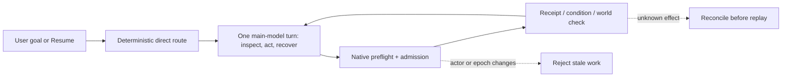

# Goal-pursuit harness experiment

## Scope and status

This is an opt-in, local-first experiment on `experiment/goal-pursuit-harness`.
`SGLUNA_GOAL_PURSUIT_MODE=direct` removes the interaction-classifier and Jev
routing decisions from the critical path. The main provider still chooses what
to inspect, the next bounded native action, strategy changes, and recovery
within the existing runtime's authoritative goal, admission, receipt, and
actor/epoch boundaries. The default remains `legacy`.

The experiment deliberately does **not** add a gameplay recipe script, a shell
tool, generated Lua, fake inventory changes, or a completion claim based on a
provider response. World-state predicates and native receipts remain the only
completion evidence.

## Design comparison

| Concern | Legacy path | Direct experiment |
| --- | --- | --- |
| Turn entry | Main interaction classifier, optional Jev signal, then planner/executor lifecycle | Deterministic new-goal/Resume routing, then one main-model lifecycle |
| Strategy | Immutable committed plan and separate planning boundaries | Main model may evolve strategy on each bounded lifecycle turn; user goal and admitted operation identity remain fixed |
| Safety | Native preflight/admission, actor/epoch fence, receipts, reconciliation | Reuses the same native safety boundary unchanged |
| Cost/latency | Extra provider and decision-provider routing can precede first action | No interaction/Jev routing call; measure time-to-first-action and provider call count from trace |
| Default | Yes | No; requires `SGLUNA_GOAL_PURSUIT_MODE=direct` |

The current first implementation keeps the existing execution lifecycle as its
transport so that persistence, uncertain-operation reconciliation, condition
waits, and real-engine evidence do not fork. It is therefore a controlled
removal of routing overhead, not a claim that legacy strategic contracts have
been erased globally.

## Known evidence and open risks

The retained October 8 Luna run made six Luna calls, consumed 132,033 input
tokens (73,728 cached), and made no gameplay action after a planner/executor
blocker handoff. It is not a controlled comparison: it used an older commit
and a different lifecycle. The direct trace must separately record provider
calls, token usage where returned, provider latency, first admitted action,
native busy/idle time, duplicate/no-progress behavior, and goal predicate
results.

Open risks are deliberately explicit: direct routing must not misclassify a
new user goal as Resume; a provider blocker remains a truthful pause, not a
world blocker; and an accepted batch is not completion. The scripted gates
cover those boundaries before the single permitted live run.

## Durable checklist

- [x] Baseline isolated at `30cb9b99`; legacy path preserved.
- [x] Reuse boundary and direct-vs-legacy design recorded.
- [x] Direct-mode configuration, route, trace, and scripted regressions complete (focused Docker: 51 tests).
- [ ] Docker static gate and relevant real-engine lane complete.
- [ ] Invariant review, clean candidate commit, shipped-runtime/mod verification complete.
- [ ] One capped fresh-world Luna run complete, or a truthful preflight/budget checkpoint retained.

## Budget ledger

At restart, account five-hour usage was 16%; the conservative stop threshold
remains 61%, with a checkpoint due by 56%. No provider gameplay call has been
made by this experiment. This document records intent and accounting only; the
live evidence packet must record actual provider responses and wall-clock
limits.
