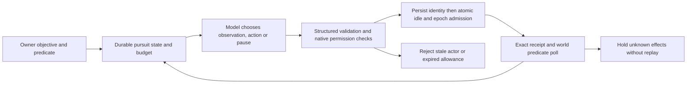

# Goal-pursuit harness experiment

This opt-in experiment now has a separate pursuit runtime and provider protocol. `8415a486` removed routing overhead; it did not implement the harness. `3c0f988f` retained the bounded core. The current candidate integrates that core with the supervisor, native permissions, operation journal, persistent campaign budget and provider bridge. Legacy remains the default.

Set `SGLUNA_GOAL_PURSUIT_MODE=direct`. An authenticated owner supplies exact JSON `{objective,predicate:{scope,summary,doneWhen:[...]}}`, or raw chat matching the exact trusted `SGLUNA_GOAL_PURSUIT_GOAL` objective. The harness does not infer completion conditions from arbitrary free text. The provider can revise notes and choose observations, bounded operations or a truthful pause; it cannot replace the objective/predicate, emit a frozen executable plan, generate Lua or claim completion.

| Concern | Legacy | Pursuit |
| --- | --- | --- |
| Decisions | Classifier, optional Jev, planner/executor | One main-model protocol; receipt/condition-driven |
| Strategy | Committed plan semantics | Revisable notes and next native batch |
| Authority | Native checks and persisted goal | Immutable owner objective/predicate; native checks |
| Effects | Correlated operation journal | Same exact journal; pending saved before dispatch |
| Allowance | Existing guards | Persistent campaign: 30 attempts, 20 minutes, 600,000 input characters including instruction prefix |
| Default | Enabled | Explicit opt-in |

Native work continues during inference. Polling running work spends no provider calls. Actor/epoch checks surround awaited reads and preflight. A final socket-send guard checks cancellation generation and deadline; native Lua checks idle before recording admission. Global admission ordinals carry across goals and use the native high-water mark. Lost acknowledgements retain immutable pending identity, block replacement and require exact reconciliation. Known pre-send refusal can clear pending with evidence. Counters are durable before calls and survive owner Resume, restart and new goals. Authorization reservations persist separately in the same atomic envelope.

Conservative permissions refuse ambiguous harvesting/destruction, name-based withdrawals and player inventory withdrawals. Exact target mutations require positive native provenance, and reserved supplies remain protected. This limits capabilities: harvesting natural wood through `harvest_product` is also refused until native source-specific protection exists. Native navigation clearing remains existing physical behavior. Cancellation can leave partial effects and truthfully holds uncertain receipts. Owner predicates are structured; this prototype has no automatic goal interpretation or actor rebinding after replacement.

## Verified build checklist

- [x] Preserve checkpoint and legacy defaults; separate real opt-in loop.
- [x] Runtime/provider, persistence, actor fences, native admission and permission integration.
- [x] Regressions for failures/restart/budgets, lost acknowledgements, model goal rewrite, retained realistic blocker, queue races, transport expiry and native text observations.
- [x] Docker all gate: 2,102 runtime tests; 1,046 mod tests; typecheck, Lua build and generated-Lua guard.
- [x] Full build gate; real Factorio pursuit and provenance lanes. Two native hand crafts consume four plates, reload between goals, keep zero humans and carry calls/ordinals to two.
- [x] Independent invariant review; three reported blockers and transport deadline gap fixed and re-reviewed. Inventory-text engine failure fixed, regression added, engine re-run green.
- [x] Candidate freeze and installer repin; all 49 deployed modules and active/engine-tested compiled mod matched.
- [x] Exactly one isolated Luna trial completed: one attempt, 41.669s to oversized-response error, no gameplay admission; truthful pause, budget/state and native save retained. Token usage unavailable.

Evidence and remaining gates: [candidate validation](validation/GOAL_PURSUIT_CANDIDATE_2026-10-10.md). The October 8 legacy run made six calls, 132,033 input tokens (73,728 cached), 1,108 output tokens and no gameplay actions. It used an older commit and a shorter/different lifecycle, so it is not a controlled comparison.

## Authority and usage

The user explicitly renewed continuation after the reset. Final milestone reading: 46% five-hour usage, 52% weekly; retain the original 56% checkpoint and 61% five-hour stop. No reset credit consumed. The single Luna allowance is consumed. See [actual result](validation/GOAL_PURSUIT_LUNA_TRIAL_2026-10-10.md); no further live attempt is authorized. No push, PR, other-worktree change, production deployment or extra live attempt is authorized.
