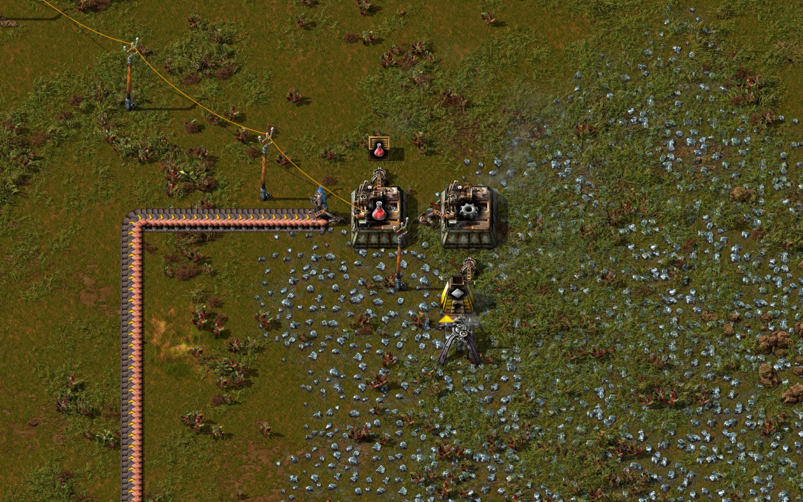
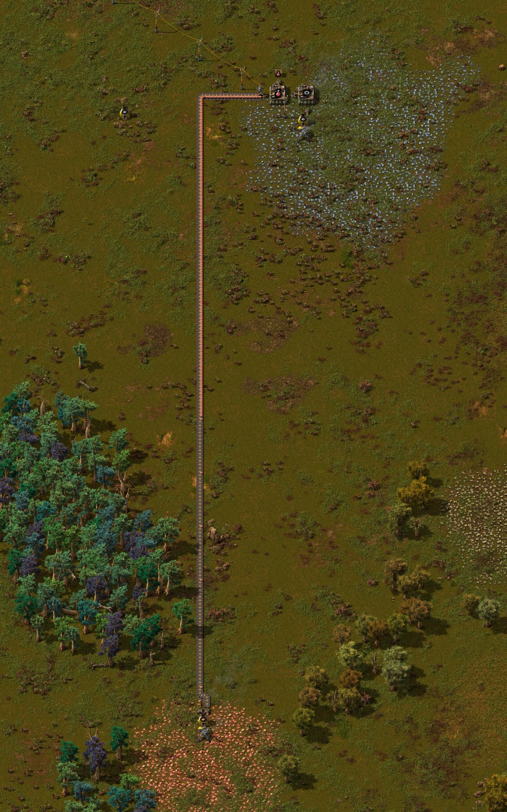
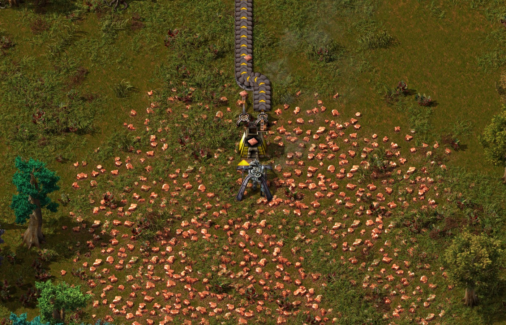
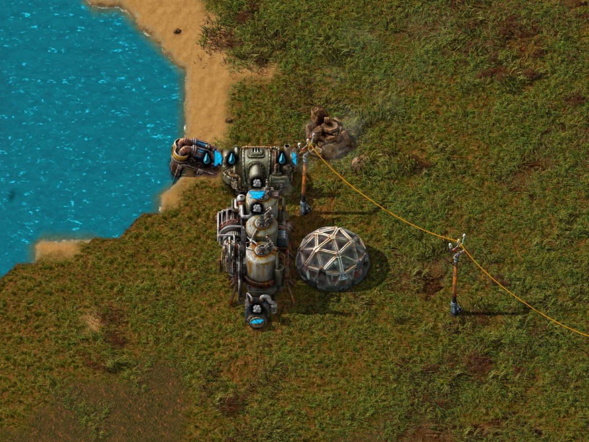

# Semi-automated red-science milestone

On October 31, 2026, an external GPT-6.1 Sol operator built a working
semi-automated red-science line through MCP. The Windows-host-to-Docker trial
used Factorio 2.0.77, normal game speed and zero connected human players.
It continued a previously saved world where Automation research and some
infrastructure already existed.

Tested source: [`9eff3407680e5f5633d8c94ffe4b1603236dce85`](https://github.com/TTLouis/factorio-npc/commit/9eff3407680e5f5633d8c94ffe4b1603236dce85).
Later knowledge-library and electric-miner changes were not part of this trial.

---

## Observed result

- Two burner miners supplied new furnaces. Assemblers and automatic item
  transport supplied intermediate production and final red-science crafting.
- The science assembler's completed-craft counter increased **16 → 22 → 28**
  across the start, middle and end of a **120.070-second** hands-off window.
  Its observed live recipe produced one science pack per craft: **12 new packs**.
  Both mining-resource totals decreased and all production counters increased
  in each half of the window. No science was hand-crafted in this trial.
- Science output went through an inserter into a storage chest. The new line
  did not supply a lab or demonstrate an automatic research loop.
- Fuel was manually loaded into the burner miners, furnaces, burner inserters
  and existing boiler during construction. No gameplay changes were made during
  the measurement window; those prefilled supplies kept the line running.
  Continuing fuel replenishment was not automated.

---

## Limits and acceptance

The furthest demonstrated result is **semi-automated science production with
manual fuel servicing**. It does not establish an independently sustained
factory, the intended electricity-first/electric-mining progression, repeatable
success, or automatic lab feeding.

The frozen E2E result remains **FAIL**. Copper furnace 40 kept the same physical
identity and its completed-craft counter increased **230 → 246 → 261**, while
its recipe metadata was absent from the later samples. The validator reported
`producer_identity_changed:40`. Capture did not distinguish a nil recipe from
a failed recipe read, so the result has not been retrospectively marked passed.

Strict stop, save integrity, pristine exact-version load and cleanup passed.
Original plans, native/tool traces, metrics and the post-stop save remain
owner-local; this page is a summary, not a replacement for those records.
A [privacy-reviewed save and its matching NPC mod](README.md#download-saves)
are available for inspection. The public ZIP has normalized archive metadata;
its game-state payload is unchanged. The original sealed save's SHA-256 is
`6d577ec9e163e6f6d45c0fc6109ca2f81223f95304342cecefe0ab98f1472438`.

---

## In-game screenshots

Captured November 1, 2026 with Factorio 2.0.77 from a separate inspection copy of
the verified post-stop save and matching native mod. The inspection is paused;
the render uses daylight and entity information overlays. Camera positioning
uses the recorded entity coordinates. No machines were rebuilt or supplied for
these pictures, and no additional autonomous trial was run.

These images document the layout after the trial. The production counts above
come from the original measurement window, not from this paused inspection.

---

### Science production and iron supply

The science assembler sends output through an inserter to a chest. Nearby gear
production and the iron miner/furnace feed the line. The burner machines and
inserters depend on the agent's earlier manual fuel loads.

---

### Material transport overview

The long belt links the distant copper source to science production. This is
the preserved trial layout, including its inefficient transport distance.

---

### Copper mining and smelting

A burner miner and stone furnace supply the copper belt. Their fuel supply was
not automated. This is the furnace whose changing recipe observation caused
the formal acceptance failure described above.

---

### Existing electricity and separate lab

The pre-existing power site supplied electricity, but its boiler was manually
fuelled. The lab is separate from the new science output; this trial did not
demonstrate automatic lab feeding or continued research.

[Back to latest proofs](README.md)
