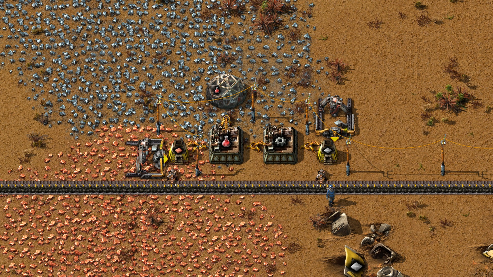
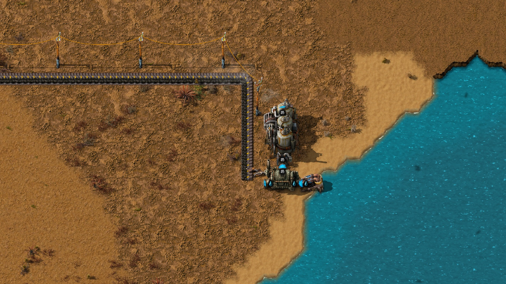
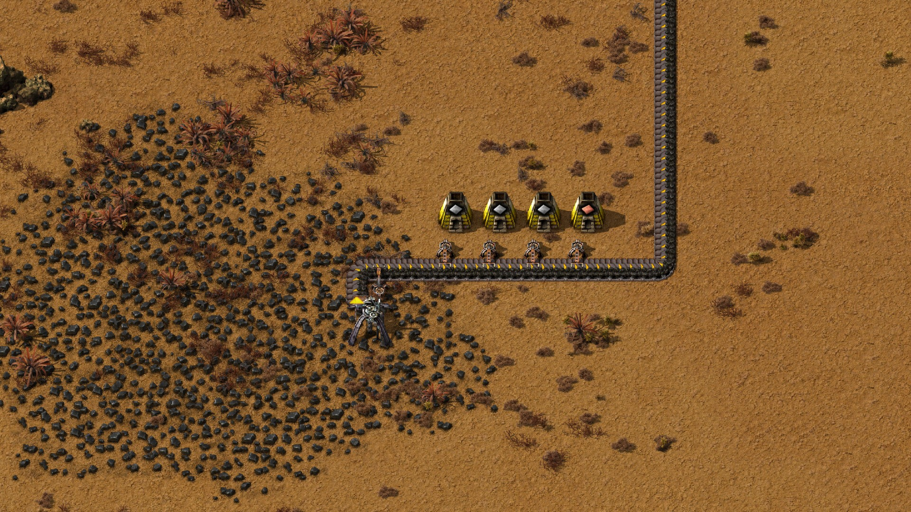
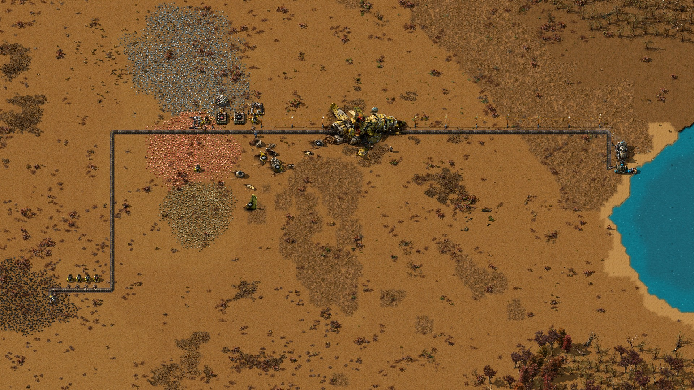

# Automatic red science and lab delivery with burner coal

On November 4, 2026, an external operator built a red-science line from an empty
NPC inventory in a fresh freeplay world. The Windows-host-to-Docker trial ran
at normal game speed with zero connected human players.

> "After seeing what the AI has build, it does remineded me of my first 'try' and
> I quit after seeing the up comming green science and did not comback untill my
> friend asked me to play with them."

| Item | Recorded value |
| --- | --- |
| Models | Claude Sonnet 5.5 (operator); Opus 5.5 (coordination) |
| Factorio version | 2.0.77 |
| Operator phase | 2 h 8 min 5.502 s |
| Hands-off measurement | 10 min 19.017 s, after the operator phase |

The science assembler's completed-craft counter increased **32 → 94** during a
**619.017-second hands-off window**: **62 new packs**, with automatic material
and fuel delivery and science fed to a lab. This is qualified evidence, below
the owner's fully electrified starter-base goal.

Tested source: [`560529b415082ab4ce5239fc1940b7fbd27c5b00`](https://github.com/TTLouis/factorio-npc/commit/560529b415082ab4ce5239fc1940b7fbd27c5b00).
The internal planner and Jev were not used.

---

## In-game screenshots

Captured November 4 from a separate inspection copy of the verified post-stop
save and matching native mod. The render uses daylight and entity information
overlays. First-player entry spawned the crash site during this later inspection;
no debris was removed for these pictures. Production counts come from the
original measurement, not these inspection images.

### Science production and lab feeding

Electric iron and copper drills feed smelting, gear production and the science
assembler. An inserter supplies the lab above it. Furnace fuel arrives from
the coal belt through burner inserters.

### Automatic fuel delivery to the power plant

The long coal belt supplies the boiler beside the offshore pump and steam
engine. The boiler was automatically supplied, but its coal source remained
a burner drill.

### Coal source and bootstrap smelting

> "I mean, this is technically automated"

The burner drill feeds the belt and receives fuel back through an inserter.
The nearby furnaces supported construction. This source supplied the final
line's fuel and explains the remaining burner dependency.

### Whole layout and late-spawning ship

Coal travels from the lower-left mining site past science production to the
power plant on the right. The ship appeared during inspection, across the
already-built belt route. It was absent during the NPC-only trial.

---

## Notes and limits

- **Automation:** the submission counter stayed at 330 throughout the measured
  window. The active production chain ended without fuel or power warnings,
  and research progress increased as the lab consumed science. Abandoned
  bootstrap furnace 38 was out of fuel; it was outside the final chain.
- **Below the full goal:** iron and copper mining were electric, but coal mining
  and several inserters remained burner-based. This does not establish the
  requested fully electrified starter base or indefinite production after
  research demand ends.
- **Declared bootstrap:** the operator inserted 8 wood into one bootstrap
  furnace and primed the first coal drill with 4 coal. The owner later allowed
  these two finite fuel inserts. Bootstrap ore transfers and hand-crafted packs
  for early research were also part of construction.
- **Crash-site startup gap:** freeplay waits for first player creation; the
  standalone NPC does not trigger it. Screenshot capture reproduced the change
  from zero players, no crash-site entities and initialization false to one
  player, 58 crash-site entities/effects and initialization true. The ship
  visibly crosses the belt route; functional damage was not tested. The
  proposed follow-up is to initialize the crash site once before NPC building
  and prevent a second crash on later player entry. **No fix was made here.**

---

## Evidence and closeout

The audit reconciles **808 tool calls**, including **325 completed operations
and 5 preflight refusals**. All 47 sealed files passed their recorded integrity
checks. The historical closeout records idle/no pending work, save preservation,
a pristine Factorio 2.0.77 load and removal of the trial's Docker resources.
It does not establish the internal runner's strict stop protocol or 60-minute
construction limit; the external operator-call span was about 2 h 8 min.

[Detailed metrics and qualifications](2026-11-04-automatic-red-science.metrics.json)
include tool counts, errors, usage and unavailable telemetry. Original findings,
Claude's closeout, plans, traces and the save remain owner-local under
`test-results/external-sonnet-redscience-3-20261103/`. The full error index and
offline audit are in its `report-20261104/` folder. Neither screenshots nor this
summary replace those records.

**[Open the preserved map in Factorio editor](<D:/SideProjects/airi-factorio-npc/test-results/map-editor-external-redscience-3/Open in Factorio editor.lnk>)**
opens an isolated inspection copy with the crash-site caveat described above.

[Back to evidence list](README.md)
