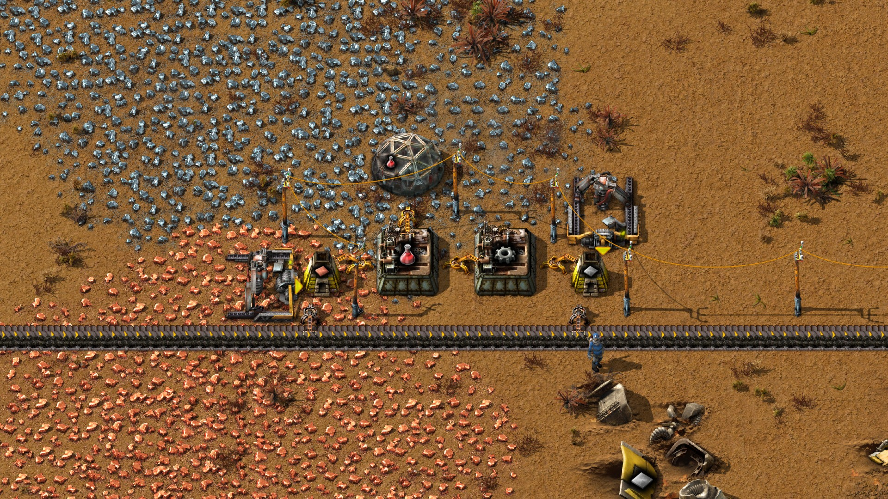
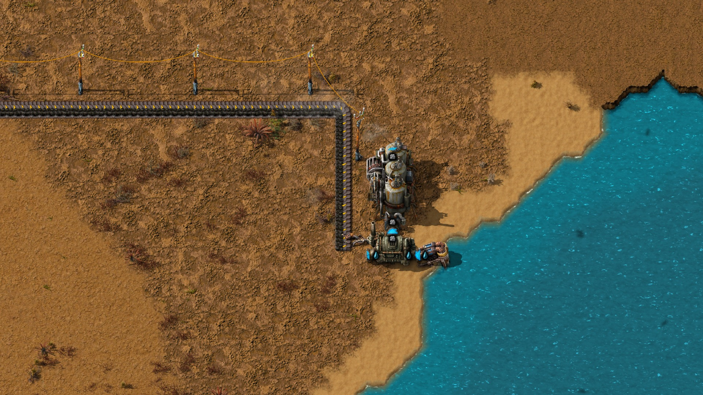
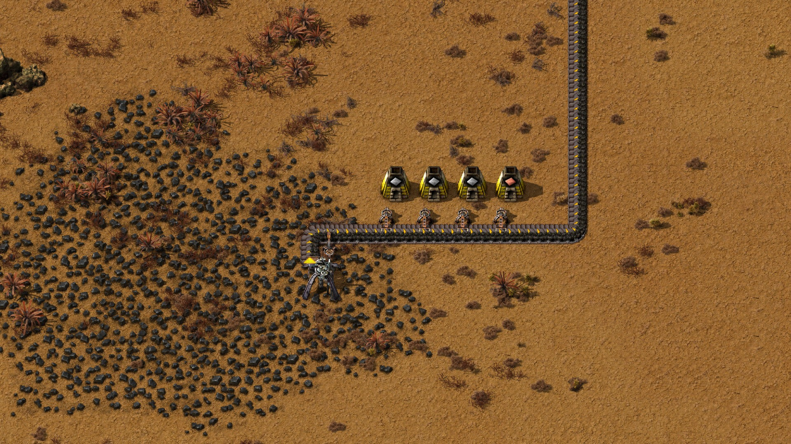
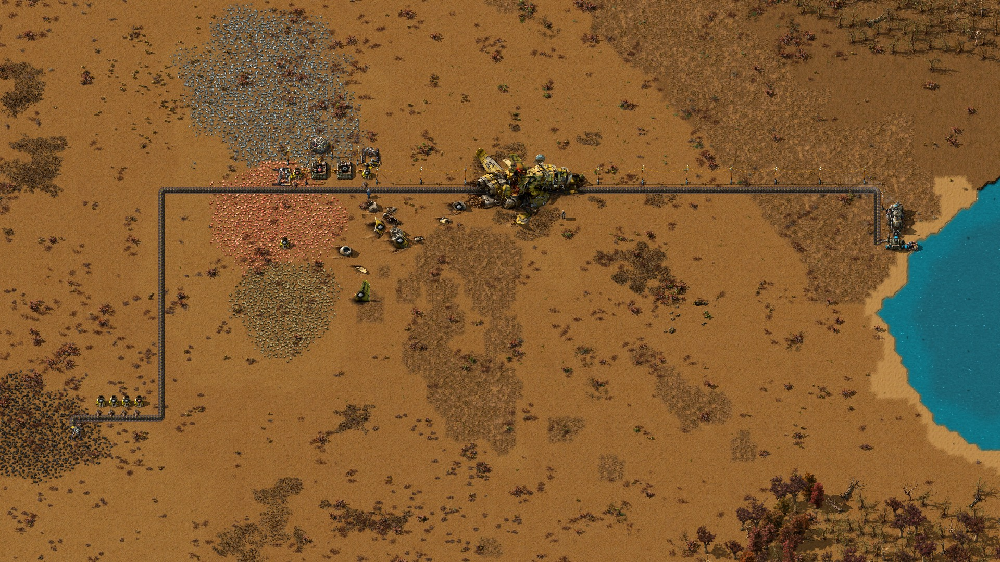

# External trial 3: automatic red science, with qualifications

Report date: November 4, 2026. Run: `external-sonnet-redscience-3-20261103`.

**The preserved native measurements show 62 new red-science packs in a
619.017-second hands-off window, with automatic material and fuel delivery and
science supplied to a lab. This is qualified evidence, below the owner's fully
electrified starter-base goal.** Coal was still mined by a burner drill, and
freeplay's crash-site initialization was deferred until the first human player
was created. The later editor inspection exposed that startup discrepancy.

This report adds the run to the evidence list without promoting it to an
unqualified success. It records proposed repairs only. No implementation,
gameplay, deployment or new trial is part of this report.

## Tested configuration and boundaries

| Field | Recorded value |
| --- | --- |
| Source | [`560529b415082ab4ce5239fc1940b7fbd27c5b00`](https://github.com/TTLouis/factorio-npc/commit/560529b415082ab4ce5239fc1940b7fbd27c5b00), external-harness `main` at trial freeze |
| Engine | Factorio 2.0.77, Linux headless, Windows host to Docker |
| Engine image | `sha256:daed5a6f7cc3c4c666a20aafe24d5cd5d8236fc220801e956c7dcc53fcc38287` |
| World | Fresh freeplay, seed 1103, empty NPC inventory, normal speed, zero connected humans |
| Actor | Standalone character; setup actor ID 24, epoch 1, surface 1, force 1 |
| Operator | Claude Sonnet 5.5 (`claude-sonnet-5-5`), three stints through the process adapter |
| Coordination | Parent Opus 5.5; its usage is outside the retained operator totals |
| Internal planner / executor / Jev | Not used |
| Operator-call boundary | November 4, 04:02:05.035–06:10:10.537 UTC; November 3, 23:02:05.035–November 4, 01:10:10.537 Toronto time |
| Measurement | Native ticks 464203–501344; submission counter 330 before and after |

The operator-call span is **2 h 8 min 5.502 s**. This external trial did not use
the reviewed internal runner's 60-minute construction contract; it must not be
compared as though it passed that gate. Its three operator stints were parts of
one world, not three independent trials.

## What was built and measured

A self-feeding burner coal drill supplied a long belt to the smelting site and
the power plant. An offshore pump, boiler and steam engine supplied electricity
through a pole line. Electric drills mined iron and copper; automatically
fuelled furnaces fed gear and science assemblers. An inserter delivered science
to a lab. The coal drill and several fuel inserters remained burner machines.

The parent measured the world through read-only RCON after the operator stopped
submitting operations. The retained `parent-measure-3.json` contains both native
snapshots; both record zero connected humans.

| Native observation | Before | After | Change |
| --- | ---: | ---: | ---: |
| Tick | 464203 | 501344 | 37141 |
| Science assembler 255, completed crafts | 32 | 94 | +62 |
| Gear assembler 256, completed crafts | 38 | 100 | +62 |
| `logistic-science-pack` research progress | 0.160000 | 0.985911 | +0.825911 |
| Submission counter | 330 | 330 | 0 |

At the recorded 1× speed, the window spans **619.017 native seconds** and the
observed science output averages **6.010 packs/minute**. This is a measured
window average, not a general capacity guarantee. Research progress and the lab
state support automatic science consumption. The historical findings report
that research finished shortly afterward; completion is outside these two
measurement snapshots.

At the end, the active production chain had no reported `no_fuel`, `no_power`
or `low_power` status. The raw measurement's `bad_end` list is **not empty**:
it names abandoned bootstrap furnace 38, which had no fuel. That furnace is
outside the final chain; it must not be silently omitted when describing the
raw artifact. The science assembler was working and the gear assembler had full
output. Blocked or full buffers are not evidence of continued production once
the lab has no research demand.

Useful inspection locations from the native snapshots:

| Structure | Position / identity |
| --- | --- |
| Science / gear assemblers | 255 at (-38.5,-7.5); 256 at (-34.5,-7.5) |
| Lab | 251 at (-38.5,-11.5) |
| Iron / copper electric drills | 252 at (-30.5,-9.5); 253 at (-44.5,-6.5) |
| Final iron / copper furnaces | 245 at (-31,-7); 247 at (-42,-7) |
| Power plant | Pump 213 at (54.5,4.5), boiler 214 at (52.5,4), engine 215 at (52.5,0.5) |
| Coal source | Burner drill 39 at (-77,34), fed back by inserter 44 |

## Manual inputs and acceptance

The historical fuel audit covers all 330 submissions and identifies two manual
fuel transfers: `r3-011-fuel-wood-BOOTSTRAP` supplied 8 wood to bootstrap furnace
38; `r3-029-PRIME-coal-drillA` primed coal drill 39 with 4 coal. The owner later
allowed one finite bootstrap-furnace insert and one coal-drill priming. Furnace
38 was never refuelled and was excluded from the final chain. The operator also
hand-fed bootstrap ore and hand-crafted science for early research; those actions
are part of construction, not the hands-off output claim.

| Requirement | Assessment |
| --- | --- |
| Automatic science inputs, production and lab delivery | Demonstrated within the measured pre-player world |
| Automatic ongoing fuel supply after the declared bootstrap | Supported by the fuel audit, belt-fed machines and measured window |
| At least 600 native seconds without submissions | Met: 619.017 seconds, counter unchanged |
| Fully electrified starter base | **Not met:** power and smelting fuel still depended on burner coal mining; electric transfers were not universal |
| Representative freeplay startup before NPC construction | **Not established:** crash-site initialization was deferred |
| First-human-join compatibility without new world interference | **Not met as an initialization invariant:** screenshot capture reproduced crash creation across the existing belt route; functional damage remains untested |
| Overall owner goal | **Below goal; retain as qualified evidence** |

## Crash-site startup issue and editor note

The owner observed wreckage during later editor inspection and explained that
it appeared after the NPC had already placed structures. They removed the
crashed-ship debris to inspect the map, then clarified that they might not have
saved the edit. This was a post-trial inspection action. There is no evidence
that this deletion occurred during construction or the measurement window.

The timing concern is supported by the installed **Factorio 2.0.77** source:

- `data/base/scenarios/freeplay/control.lua` loads the base freeplay controller.
  Its `data/base/script/freeplay/freeplay.lua` handler at lines 70–95 inserts
  player items and performs one-time initialization inside `on_player_created`.
  Crash creation is at line 84, guarded by `not storage.init_ran` and
  `not storage.disable_crashsite`; event registration is at line 235.
- The trial source's
  [`actor_controller.ts`](../../packages/autorio/src/actors/actor_controller.ts)
  creates the NPC through `StandaloneCharacterActor.create`. The corresponding
  [`standalone_character_actor.ts`](../../packages/autorio/src/actors/standalone_character_actor.ts)
  creates a `character` entity without a `LuaPlayer`. This does not run the
  freeplay player-created handler. These paths were inspected at the trial SHA.
- The inspection log records repeated editor-entry refusals before
  `editor_ready ... controller=editor tick_paused=true` at elapsed 42.149 s.
  The helper tries to enter the editor during player creation/join and on ticks;
  its temporary refusal is consistent with the intervening crash cutscene. The
  owner's wreckage observation supplies the direct inspection evidence.

Precisely, the trigger is **first player creation**, not every player join.
An NPC-only fresh world can therefore build before the one-time crash site
exists. Later player creation can introduce wreckage, effects and changed
terrain context into an already built area. The startup omission belongs to
the world/harness boundary; it does not show that the operator bypassed a
placement refusal. Its earlier placements were admitted against the world that
actually existed at the time.

**Functional damage to a particular NPC structure has not been measured.**
The later screenshot capture below reproduced native crash creation and shows
the main ship visually crossing the existing coal-belt route. This is direct
layout evidence; collision state, belt continuity and production after that
event were not tested. The crash helper's main-ship creation and individual
debris placement use different placement logic; debris includes collision
searches. Thus this report does not assert that every wreck necessarily spawns
on top of existing machines. The demonstrated problem is late initialization
and its resulting qualification of the trial's starting conditions.

The inspection `checkpoint.zip` still has the exact sealed-save SHA-256:
`61e6c67634b55bed800d6e03b6d94c7f48993b5d7e88c62fa7bb1fb6e1eae8be`.
The profile's source and checkpoint hashes agree. The log also records saving
`_autosave1` at elapsed 62.699 s; a separate autosave exists and differs from
the checkpoint. It contains inspection-session state, whose specific edits
were not decoded. Consequently **the source checkpoint is unchanged, while
persistence of the owner's debris deletion remains unknown**. No inspection
autosave or debris-deleted view is used to establish native trial production.

Proposed repair, **not implemented here**: initialize the crash site as part of
the first NPC startup, before placement is admitted; make that initialization
durable and exactly once; reconcile it with freeplay so the first later human
does not create a second crash. Preserve zero-human operation and the declared
starter inventory policy. A later implementation needs exact-version native
proof for initial startup, save/reload and subsequent first-player creation,
including already-initialized and crash-disabled worlds. Existing built worlds
need an explicit safe disposition rather than blindly spawning wreckage into
their factories. A prompt asking the operator to avoid spawn does not repair
the shared startup boundary.

## Tool use, execution and errors

The offline audit parsed every line of the sealed operator log. All **808 calls**
reconcile, including **330 submissions = 325 completed admitted operations +
5 preflight refusals**. All 325 admitted identities have a completed,
`effect: happened` receipt. A successful tool reply alone is not native
production proof. Cached/coalesced tool-call counts are unavailable.

| Tool | Attempted | Successful replies | Failed/refused | Mean wall ms |
| --- | ---: | ---: | ---: | ---: |
| `factorio_submit` | 330 | 325 | 5 | 4625 |
| `factorio_receipt` | 260 | 250 | 10 | 11535 |
| `factorio_observe` | 200 | 194 | 6 | 2513 |
| `factorio_capabilities` | 7 | 7 | 0 | 1542 |
| `factorio_context` | 7 | 7 | 0 | 2780 |
| `factorio_library` | 4 | 3 | 1 | 1445 |

| Operation | Attempted | Completed | Refused | Observed native ticks |
| --- | ---: | ---: | ---: | ---: |
| Place entity | 215 | 213 | 2 | 11345 |
| Transfer exact items | 41 | 40 | 1 | 3334 |
| Walk | 24 | 24 | 0 | 8134 |
| Craft | 22 | 21 | 1 | 26447 |
| Hand mine | 15 | 14 | 1 | 135863 |
| Place candidate | 5 | 5 | 0 | 217 |
| Start research | 4 | 4 | 0 | 176 |
| Set machine recipe | 2 | 2 | 0 | 88 |
| Harvest | 1 | 1 | 0 | 1420 |
| Explicit wait | 1 | 1 | 0 | 1563 |

These ticks are receipt intervals, including any work within the operation;
they are not exclusive physical-action timing or a count of each placed native
batch task. Separate native batch/slot totals were not extracted. About 72% of
the 188587 counted operation ticks belonged to hand-mining operations. These
intervals overlap tool waits and must not be added to them as extra wall time.

The terminal/error index covers all 22 non-success calls, not only the five
refused mutations. Call-line numbers below refer to sealed `operator-calls.jsonl`.
The external mode has no internal planner goal/plan/step terminal streams.

| Event | Count / log lines | Cause and disposition |
| --- | --- | --- |
| Placement footprint occupied | 2; 262, 368 | Actor on belt footprint (`r3-089`, `r3-136`); expected safety enforcement, unsent; later placements succeeded after repositioning |
| Supply missing | 1; 229 | `r3-066-in-57`; unavailable inventory, unsent; correctly refused |
| Recipe locked | 1; 604 | `r3-282-cr-edrill`; `getRecipeDetails` reported `enabled:false` with `craftable_now:true`; crafting correctly refused. Source-backed observation defect: `bootstrap_planning.ts` derives the latter from craftable count without the enabled flag |
| Resource source insufficient | 1; 630 | `r3-286-mine-fe`; thin ore tile, unsent; guard enforced, useful per-tile amount unavailable to operator |
| Empty receipt operation ID | 7; 230, 605–607, 631–633 | Operator helper read no operation ID after a refused submit; bounded RPC errors, not native retries |
| `mcp_exited` | 2; 156, 658 | Overlap with calls 157 and 659 respectively; opaque process-adapter concurrency failure, then same-operation receipt retrieval completed |
| `journal_write_failed` | 1; 208 | Receipt for `r3-058-cu-ore2`; no overlapping logged call. Ledger-write cause was discarded; infrastructure/harness attribution remains uncertain. Later receipt for the same operation completed |
| Invalid observation arguments | 6; 518, 519, 589, 611, 614, 615 | Invalid names/bounds; correctly refused without world action |
| Missing library action | 1; 623 | Required argument omitted; bounded RPC error |

No admitted operation ended failed or unresolved in the audited call stream.
There were three completed receipt-retrieval recoveries after the two adapter
failures and one journal failure, with no mutation replay. They are distinct
from harness automatic recovery: external mode has no such autonomous loop.
Recorded `factorio_resume` and `factorio_cancel` calls are zero. The historical
closeout records no parent gameplay intervention. The owner's later debris
deletion is separately disclosed above; it is not a trial recovery.

## Plans, usage and time

The original operator brief and checkpoint remain sealed. The checkpoint's
outline is: bootstrap plates and a self-fed coal drill; expand coal-fed
bootstrap smelting; extend coal transport to water; build electricity and poles;
research and build electric iron/copper mining, science assembly and lab feeding.
Electric coal drilling was conditional on demand and was never implemented.
That planning choice explains the gap to the owner's electricity-first goal.
There are no internal immutable Active Plan or Roadmap Shelf objects in this
external mode. The prose checkpoint is the issued operator history, not a later
reconstruction of a harness plan.

The existing closeout metrics, derived from deduplicated operator assistant
message IDs, report 215 requests across stints of 82, 40 and 93. Reported token
usage is 432 ordinary input, 542205 cache-creation input, 26147280 cache-read
input and 135129 output tokens. Parent coordination and this reporting chat are
excluded. This report reuses those usage totals; it did not reread private
transcript message contents. API failures, retries, cancellations, fallback
counts and reasoning-token usage are unavailable from this audit, not zero.

Summed tool-call wall durations are 5063.963 s; their union is 5063.420 s because
some calls overlap. The full call-log span is 7685.502 s. The remainder cannot
be called measured LLM thinking time. Per-request model latency and thinking
duration are unavailable. Tool averages range from about 1.4–11.5 s; individual
receipt calls range from 0.266–32.787 s. Build/preflight and stop/save/cleanup
durations are not established here. The 619.017-second production measurement
is a separate phase and is not inside the operator-call span.

**Cost remains unpriced.** Neither a pricing source/date nor verified rates for
the recorded model were retained; no new rate lookup was performed. Currency,
token-price equivalent and billed amount are unknown. Claude Code subscription
token usage is not evidence of an incremental API charge. Missing usage and
unpriced calls prevent a complete monetary estimate.

## Findings and proposed follow-up

1. **Initialize the freeplay crash before NPC building.** This is the new startup
   finding; required behavior and proof are described above. No fix is claimed.
2. **Require the intended electrical progression.** A later trial must explicitly
   require electric coal extraction and the intended electric transfers, rather
   than treating electric coal as a demand-triggered optional step.
3. **Make craftability facts agree with research locks.** Preserve the current
   native refusal; correct the conflicting advisory observation at its source.
4. **Expose adapter and ledger failures clearly.** Report lock contention and
   the native journal-write error cause; do not retry uncertain mutations.
5. **Reduce placement overhead and improve ore observations.** The operator
   requested bounded line placement and per-area/per-tile resource amounts.
   These are capability proposals, not permission to bypass placement guards.
6. **Keep research demand explicit.** The line can fill and stop when research
   completes. A ten-minute window does not prove indefinite productive demand.

The fluid-network cap was documented and five candidate placements completed.
No guard refusal for that bound appears in the covered log. That establishes
neither that the new cap-annotation branch ran nor that it prevented a failure;
dedicated branch telemetry was not extracted. No path in the internal planner,
executor, Jev, automatic recovery or accelerated tick-sprint controller is
claimed exercised.

## Screenshots and reproduced crash initialization

Captured November 4, 2026 with the installed Factorio 2.0.77 graphics executable
from a new isolated copy of the sealed checkpoint. Its 32 native-mod files were
verified against the existing manifest (text hashes use the manifest's newline
normalization). A separate capture-only helper requested four native renders
and paused the inspection simulation at capture tick 502704. Rendering used
daylight and entity-info overlays, with GUI hidden. Camera and rendering changes
are inspection aids, not changes to the trial's measured state.

Loading a graphics inspection creates a local player and triggers freeplay.
The capture log supplies this before/after observation in the fresh copy:

| Capture phase | Players / connected | Crash-site entities in inspected area | `freeplay.get_init_ran` |
| --- | ---: | ---: | --- |
| Configuration, before local-player creation | 0 / 0 | 0 | false |
| Capture after local-player creation | 1 / 1 | 58 | true |

The bounded inspected area was (-120,-100)–(100,100); the count includes
crash-site effects as well as wreckage. These records reproduce the deferred
initialization mechanism in the preserved map. They are **post-trial inspection
evidence**, not new zero-human trial measurements. No debris was deleted or
hidden for these images. The original sealed save, original inspection
checkpoint and capture checkpoint retain their matching hashes. No inference
or autonomous trial was started. The temporary capture processes are no longer
running. Capture scripts and logs stay outside the sealed evidence.

### Science production and automatic lab feeding

The science assembler sits between copper smelting and gear production, with
the lab above it. Electric drills supply iron and copper; burner inserters feed
furnace fuel from the coal belt. Wreckage visible below the belt was generated
on this later inspection load, after the production measurement.

### Coal-fed electricity at the water

The long coal belt feeds the boiler through an inserter. The pump and steam
engine supply the electric network. The fuel source remains the burner drill
shown below; this image does not establish electric coal extraction.

### Burner coal source and bootstrap smelting

The burner coal drill feeds the belt and receives fuel back through an inserter.
Four bootstrap furnaces stand beside the belt. These are distinct from the
abandoned, singly hand-fuelled furnace 38 and from the final science-site
furnaces. This image makes the remaining burner dependency visible.

### Whole layout and late-spawning main ship

The overview connects the coal source, science site and distant power plant.
The main crashed ship crosses the already-built belt route near the middle.
It was spawned by first-player initialization during this inspection, not
present during the NPC-only production window. The visual overlap is retained
instead of removing the ship for a cleaner picture. Post-crash belt function
and damage were not measured.

## Preservation, closeout and evidence access

The offline report audit verified all **47 sealed files, 7227821 bytes**, against
their existing manifest lengths and hashes. The sealed save and inspection
checkpoint both pass ZIP integrity checks (55 entries each), and their hashes
match. The separate inspection autosave also passes ZIP integrity; this does
not validate or identify its edits.

Claude's workspace-level `closeout-20261104/CLOSEOUT.md` was used alongside the
original `FINDINGS.md`. It adds the journal-write failure missed by the original
findings. The alternate path supplied under the historical Claude worktree was
absent when inspected; this report used the existing workspace-level closeout
for the same run and does not claim the absent file was compared.

The historical closeout records native idle/no pending work, server save,
graceful stop, preservation and removal of the owned container and network. Its
pristine-load log confirms the save loaded in exact Factorio 2.0.77 and ran 60
updates, then exited normally. That check does not create a human player and
therefore does not prove first-player crash compatibility. Fresh Docker cleanup
was not rerun for this report. Internal-run supervisor-cancellation and
same-goal operator-pause receipts are not present in this external-mode record;
full compliance with that internal stop protocol is not claimed. Calls after a
strict stop boundary and parent provider usage are not independently reconciled.

Owner-local evidence paths below are relative to the shared workspace
`D:/SideProjects/airi-factorio-npc`, not files shipped with this repository:

| Artifact | Workspace-relative location |
| --- | --- |
| Original findings | `test-results/external-sonnet-redscience-3-20261103/FINDINGS.md` |
| Claude closeout and original metrics | `test-results/external-sonnet-redscience-3-20261103/closeout-20261104/` |
| Immutable raw evidence | `test-results/external-sonnet-redscience-3-20261103/sealed-20261104/` |
| Original file inventory | `test-results/external-sonnet-redscience-3-20261103/SEAL_MANIFEST.json` |
| Updated metrics, complete error index and offline checker | `test-results/external-sonnet-redscience-3-20261103/report-20261104/` |
| New screenshot capture, startup observations and native render originals | `test-results/map-report-external-redscience-3-20261104/` |
| Inspection checkpoint, profile, log and separate autosave | `test-results/map-editor-external-redscience-3/` |
| Paired private ledger | Retained owner-local with the original save; excluded from public artifacts |

[Machine-readable report summary](2026-11-04-external-trial-3.metrics.json)
contains public counts and qualifications. Full traces, private ledger and saves
remain local and are not staged or published. Four native screenshots accompany
this entry; production counts still come from the original native window.

Owner-local shortcut:
**[Open trial 3 in Factorio editor](<D:/SideProjects/airi-factorio-npc/test-results/map-editor-external-redscience-3/Open in Factorio editor.lnk>)**.
It opens an isolated inspection copy; first-player crash creation is part of the
known caveat. Screenshot capture used a separate copy, leaving this profile and
the sealed save untouched.

[Back to evidence list](README.md)
