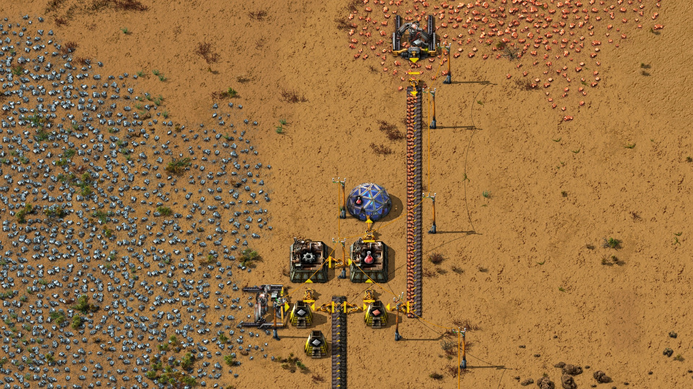
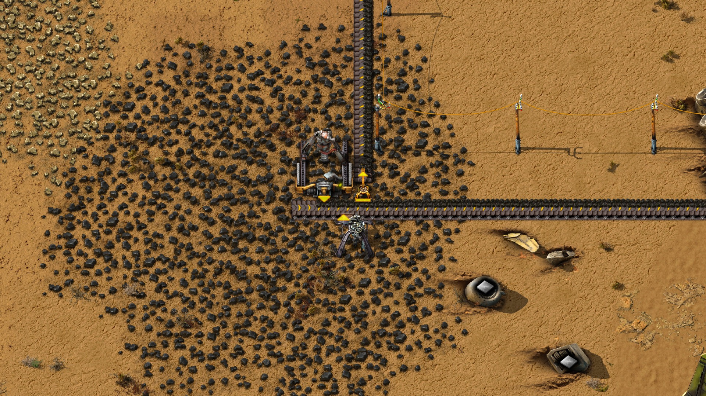
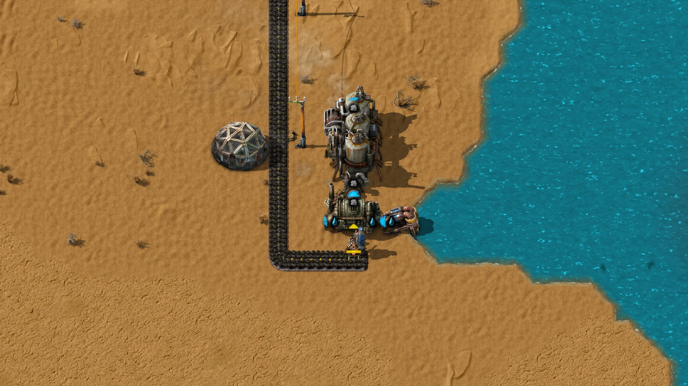
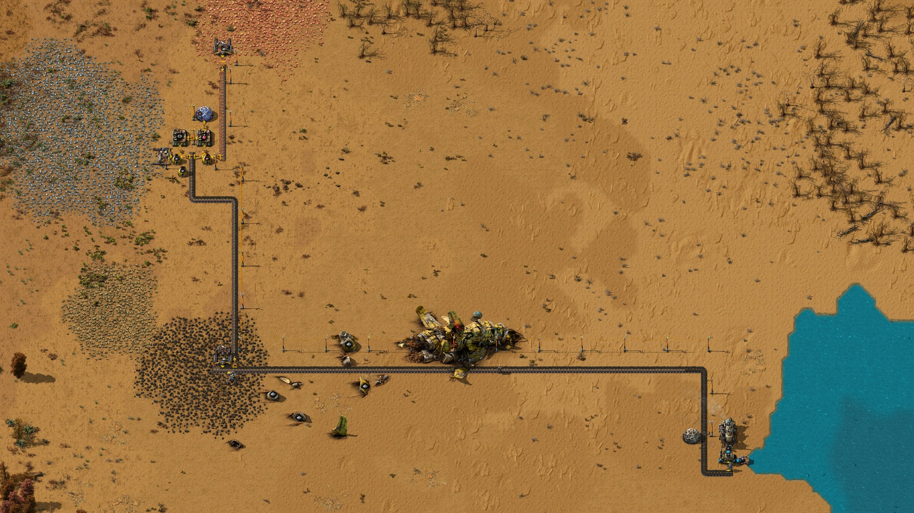

# Electrified starter base with automatic red science

An external operator built a starter base with electric coal, iron and copper
mining, automatic furnace and boiler fuel delivery, and red science fed into a
researching lab. During an independent **619.583-second hands-off window**, the
science assembler's completed-craft counter increased **182 → 203: 21 new packs**.
No operator tool calls occurred during that window.

Electric mining and automatic fuel service extend the
[previous proof](2026-11-04-automatic-red-science.md).

| Item | Recorded value |
| --- | --- |
| Models | Claude Sonnet 5.5 (operator, two stints); Opus 5.5 (coordination and independent measurement) |
| Factorio version | 2.0.77 |
| World | Fresh freeplay, seed 1104; empty NPC inventory, nothing researched; normal game speed, zero humans |
| Trial dates | November 4–5, 2026 UTC |
| First to last tool call | 2 h 24 min 38.598 s, including the independent measurement and final receipt check |
| Hands-off measurement | 37,175 native ticks, or 10 min 19.583 s of game time |

Tested source: `17f9fc39be7f17167d67075d4db9783bc3020734`.
The Windows-host-to-Docker trial used the external harness's process adapter.
The internal planner, executor and Jev were not used.

---

## In-game screenshots

Captured November 5 from a separate copy of the verified post-stop save with
the exact matching native mod. The pictures use daylight, Alt-mode entity icons
and direction arrows. Production figures come from the original measurement.
First-player entry in the capture copy spawned the crash site, which was absent
from the NPC-only trial. No debris was removed or production layout changed for
the pictures. The overview shows the ship overlapping the belt route; functional
effects of that later spawn were not tested.

### Electric mining, smelting and science delivery

> "This AI still has no idea what it is doing. Mining ore onto the ground and
> then picking it up using an inserter?"

Electric iron and copper drills supply separate furnaces. Inserters deliver
plates to the gear and science assemblers, move gears between them, and feed
science into the lab. Both furnaces receive coal automatically from the shared
fuel belt. This is a minimal layout: one furnace per ore.

### Electric coal supply

> "Using an inserter as a makeshift splitter, eh?"

The electric coal drill supplies the boiler and both furnaces. The nearby burner
drill was used for bootstrap and had no fuel during the measured window; it was
outside the final production chain. One electric coal drill serves the whole
base, with no redundant source.

### Automatically fuelled steam power

Coal arrives by belt. The boiler inserter fuels itself from the coal it handles,
so the boiler required no hand fuel. The offshore pump, boiler and steam engine
were working at both measurement endpoints. A pole line connects this plant to
mining and science production.

### Whole layout

The science site is northwest of the coal patch; the power plant is beside water
to the east. Batch line placement built the long belt and pole routes. The ship
and debris appeared only when this inspection copy created its first player.

---

## Measured result and limits

| System | Native result |
| --- | --- |
| Central steam power with coal from electric mining | Electric coal drill supplied the boiler by belt and inserter; pump, boiler and engine working at both endpoints |
| Electric iron and copper mining | Both electric ore drills supplied the final smelting chain |
| Separate smelting with automatic service | One iron furnace and one copper furnace; automatic ore, fuel and plate handling |
| Red science delivered to a consuming lab | Science crafts **182 → 203**; gear crafts **188 → 206**; research progress **24.329% → 44.982%** |
| Bootstrap fuel | All 151 submissions audited: 40 coal into the bootstrap furnace once, and 20 coal to prime the first coal drill once; no other hand-fuel moves |
| At least 600 seconds without submissions | **37,175 ticks**, counter fixed at **151**; no fuel or power warnings in the final chain at the end |

Construction included manual ore handling, unloading plates and feeding
hand-crafted science for early research. The final chain receives its inputs
automatically. The figures above come from the independent measurement after
construction.

Output was about two packs per minute in this window, with assemblers and
furnaces backing up behind research demand. The layout has one furnace per ore,
one electric coal drill and a self-fuelling burner inserter at the boiler.
Operation beyond the measurement window and uninterrupted power between endpoint
samples were not measured.

The trial ran with no crash site and zero humans. Capture reproduced the
[startup limitation recorded in the previous proof](2026-11-04-automatic-red-science.md#notes-and-limits):
zero players, no crash-site entities and initialization false became one player,
58 crash-site entities or effects and initialization true. The ship overlaps
the coal-belt route. Continued operation after that spawn remains unproven.

---

## Harness findings

`place_line` completed **13 lines containing 158 belts and 19 poles**. Four
other line submissions were refused at preflight and one received a journaled
native rejection. No partial-line receipt occurred, so the live trial does not
prove that recovery path. Total submissions were 151, versus 330 in the previous
trial; the goals and builds differed, so this is not a controlled performance
comparison.

Ground copper ore blocked belt placement; the operator worked around it with
an inserter. Two line starts were blocked by the actor standing on the first
tile. Those refusals enforced placement rules. Other feedback concerned an
unsupported-placement message that omitted the candidate-placement alternative,
observation limitations, and operator helpers making invalid or overlapping
receipt calls.

One journaled line rejection reported refusal before mutation without native
blocker details, leaving its cause unknown.

An earlier, separate trial was interrupted by a host restart after 43
submissions. Its ledger was ahead of the latest autosave, and the harness
correctly refused rollback. This trial started in a fresh world; the interrupted
world's activity and model usage are excluded from the totals below. Recovery
from an unpaired save and ledger remains a limitation.

---

## Evidence and save downloads

The final operation completed with no outstanding work before the world was
saved at tick **521655**. The preserved save passed ZIP integrity checks and
loaded in Factorio 2.0.77 with its exact matching native mod. Trial containers
and the network were removed. Detailed traces, measurements and original saves
are retained locally.

A [privacy-reviewed save and matching NPC mod](README.md#download-saves) are
available for inspection. Public ZIP metadata is normalized and game-state
payloads are unchanged. The public copy loaded with exactly base and Autorio in
Factorio 2.0.77, with zero human player records and the standalone NPC preserved.

---

## Run statistics

The full call log contains **725 calls**. A zero exit is a tool reply, not proof
of a successful game operation: one journaled rejection was returned through a
successful receipt call.

| Tool | Calls | Nonzero exits | Average call time |
| --- | ---: | ---: | ---: |
| Capabilities | 2 | 0 | 1.236 s |
| World context | 6 | 0 | 2.452 s |
| Method library | 4 | 1 | 0.917 s |
| Game observations | 322 | 3 | 2.234 s |
| Operation submissions | 151 | 7 | 4.139 s |
| Operation receipts | 240 | 48 | 9.250 s |
| **Total** | **725** | **59** | |

The **151 submissions** reconcile to **143 completed operations**, **seven
refusals before journaling**, and **one journaled rejection**. The 59 nonzero
tool exits comprise 42 empty receipt IDs, six overlapping-call locks, six
preflight refusals, one unsupported placement, three invalid observations and
one invalid library query. No admitted operation remains unresolved. Receipt
polling observes the same operation and is not counted as another mutation.

No operator resume or cancel was recorded. The operator adjusted subsequent
requests after refusals; those
adjustments are not harness auto-recovery. Internal planner reviews and
auto-resumes do not apply to this workflow.

**Time:** the first-to-last-call span was **2 h 24 min 38.598 s**. Tool intervals
cover **59 min 43.805 s** of that span, counting overlaps once. The hands-off
measurement is included in the overall span. Separate build, cleanup, model
request latency and measured thinking time are unavailable; the remaining
elapsed time must not be labelled thinking time.

**Model usage:** **200 Sonnet 5.5 requests**,
**29,745,119 cache-read input tokens**, **454,123 cache-creation input tokens**,
**400 other input tokens**, and **141,220 output tokens**, across two operator
stints. Coordinating Opus usage,
failure/retry/fallback and cancellation counts, and reasoning-token counts were
unavailable. No Jev or internal NPC planner/executor requests were made.

Usage ran through a Claude Code subscription. Actual billed cost is unknown;
no token-price estimate is given because applicable pricing was not retained.
Usage totals exclude the interrupted predecessor and this later reporting work.

[Back to evidence list](README.md)
