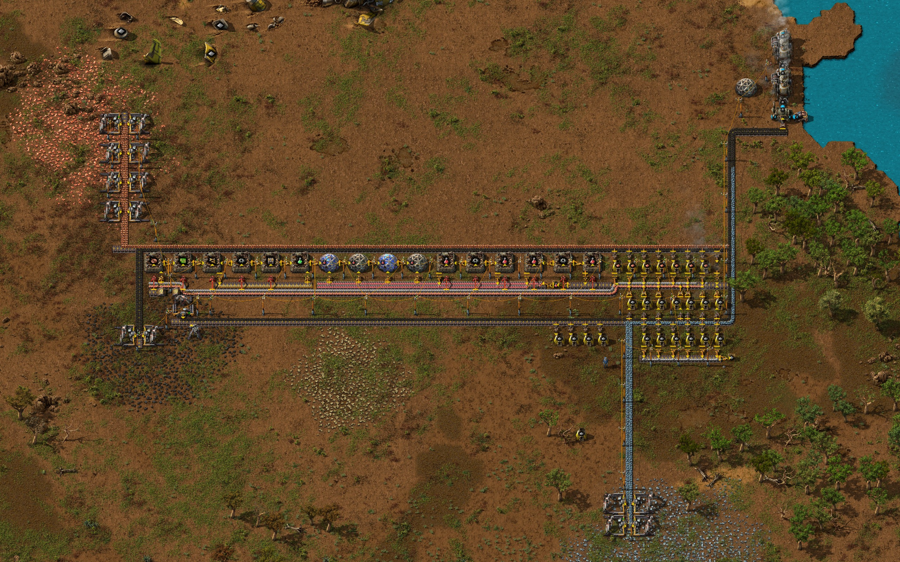
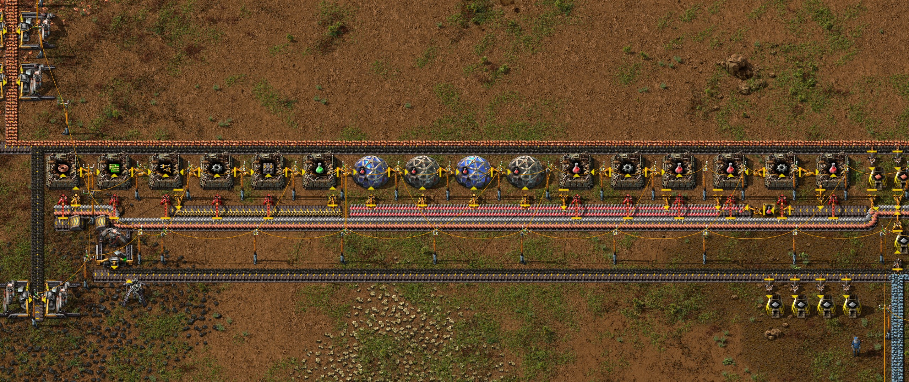
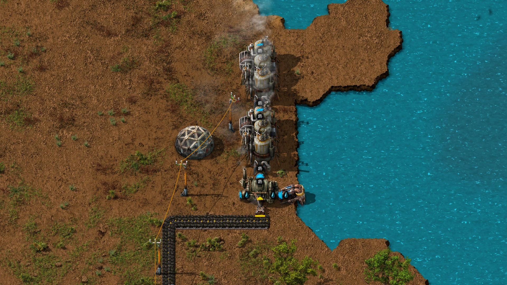
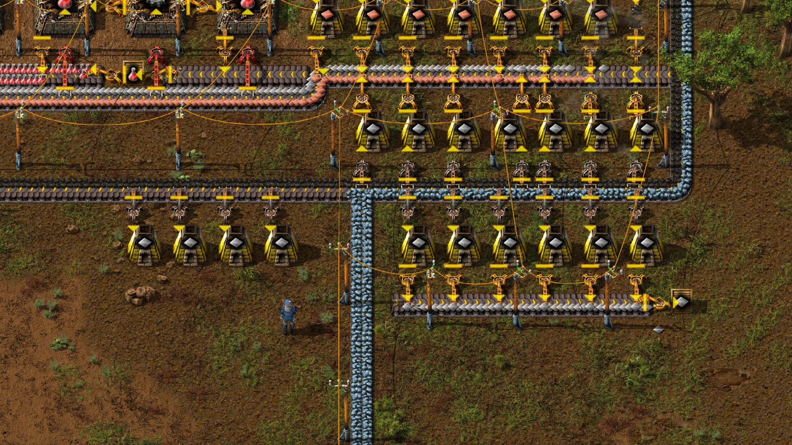
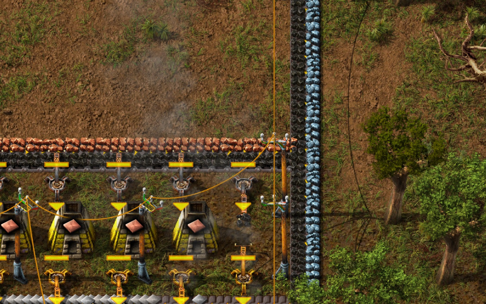

# Electrified starter base with automatic red and green science

An external AI operator built an electrified starter base that mined and
smelted iron and copper, made red and green science, and supplied its own labs.
In a **20-minute hands-off game window**, the base made **120 red and 100 green
science packs** and completed advanced material processing. The base worked at
starter scale and fell short of the trial’s throughput, research and expansion
targets.

| Run | Recorded conditions |
| --- | --- |
| Trial | External harness Trial 6, November 9, 2026 |
| Engine | Factorio 2.1.24, fresh freeplay, seed 1108 |
| Start | Vanilla crash-site starter items, no research, zero humans |
| Operator | Claude Sonnet 5.5 through the external harness process adapter, 348 requests across five stints |
| Construction | About 3 h 04 min at normal game speed |
| Tested source | `e7dd3a8db4d6339b33f41175d4fe61d0c72e5943`, a local trial candidate |

[Download the save and matching mod](README.md#download-saves)

## In-game screenshots

Captured in Factorio 2.1.24 at tick 736547 from a separate copy of the post-stop
save with the matching native mod. Production figures come from the original hands-off window.

Electric drills feed the base from three resource patches. The science row
occupies the strip between the copper trunk and the main coal and iron trunk.

The green science assembler sits left of the labs. The red science assemblers
sit to their right, and the red pack belt runs just below the lab row.

The burner inserter takes coal from the belt and feeds the boiler. The offshore
pump supplies water to the boiler, and the two engines sit above it.

## What ran on its own

Once the operator stopped, a separate measurement ran for 72,000 native ticks
in about 157 wall seconds. It was set to 8× speed and achieved 7.65×. There were
zero operator calls and zero humans in the window, and the NPC’s inventory
stayed unchanged. Counts and rates come from native production statistics
sampled across 72,092 ticks, including 92 ticks outside the timed window. Rates
are per game minute.

| System | Measured result | Trial target |
| --- | --- | --- |
| Power | Electric coal mining fed the boiler by belt and a self-fuelling burner inserter. The pump, boiler and two steam engines worked at both checks. No consumer showed low power in the checks. | Met at the load tested. |
| Iron | 791 plates, **39.5/min** | About 450/min. |
| Copper | 328 plates, **16.4/min** | About 225/min. |
| Red science | 120 made and 101 consumed, **6.0/min** produced | About 30/min, delivered to labs. |
| Green science | 100 made and 100 consumed, **5.0/min** produced | About 30/min, delivered to labs. |
| Research | Eight of ten target technologies complete, with six researched using the base’s own packs. Electric energy distribution 1 reached about 22%. | All ten from the base’s own packs. |
| Expansion | The smelting and science rows ran out of clear space to extend. | Room to extend production lines. |

Construction used two declared hand-fuel moves, one to start the first furnace
and one to prime the first coal drill. The operator also hand-fed ore during
bootstrap and inserted hand-crafted red packs to unlock automation and electric
mining. Those two technologies are excluded from the six credited to automated
science. The final production chains received their inputs automatically.

## Two belt design problems

**Iron ore shared the boiler’s coal belt.** The operator side-loaded ore at
`(29,41)` onto the opposite lane from coal so the same belt could feed the iron
furnaces and carry coal onward to the boiler. This served the starter array.
The post-stop view shows iron ore queued in its lane beyond the last furnace,
where the belt continues toward the boiler. The coal lane remained usable
during the test. West of the ore join, four furnaces received coal but lacked an
ore feed, which also constrained extension of the row. The operator’s checkpoint
records the lane assignment and routing. Its reason for preferring a shared
trunk is unknown.

**The copper trunk feeds into the main trunk.** At `(42,31)`, the eastbound end
of the copper ore and coal belt meets the northbound main trunk at `(43,31)`.
The editor inspection identified the unintended connection, and native receipts
confirm both placements and facings. This gives copper ore a route into the main
trunk. The amount that crossed and any effect on production were unmeasured.
The rest of the inspected layout functioned at the observed load.

## What guidance the operator received

- **System prompt and harness.** The recorded system prompt contained generic
  agent instructions. The Factorio tool guidance covered how to play through
  native actions, inspect live game facts and verify what happened. The AI
  chose the layout and submitted the placements.
- **Trial brief.** The goal specified steam power with at least two engines,
  electric coal supply, belt-fed smelting and automatic red and green science
  delivery. It specified throughput and research targets. The operator worked
  out the routing, coordinates and machine counts using live observations.
- **Leveled method library.** The trial offered nine knowledge references,
  58 skills and six stage records on demand, including methods for validating
  belt merges, leaving expansion room and sizing from live rates. The operator
  listed stage summaries twice and opened zero full entries. This trial leaves
  open how using the detailed methods would affect the design.

## Stop and save

The operator stopped after judging that the boxed-in layout and remaining
operation budget made an expansion impractical. Of 388 submitted operations,
355 completed, one walk was partial and 32 were refused before admission. The
NPC was idle with an empty queue before measurement. The post-stop save loaded
in Factorio 2.1.24 with the matching mod, and the run’s isolated Docker resources
were removed. The downloadable copies passed ZIP integrity and privacy checks,
and the save contains zero human player records.
